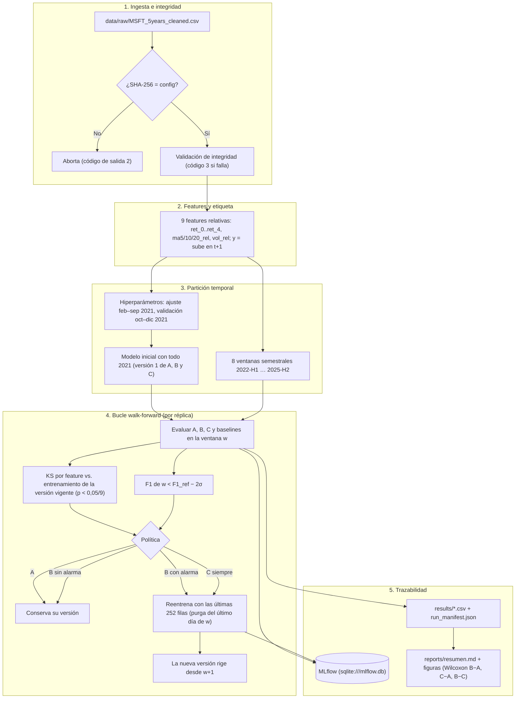

# TAIS_H2_MLOPS: Framework Experimental de MLOps en Series Temporales Financieras (MSFT)

[](https://www.python.org/)
[](https://astral.sh/uv)
[](https://mlflow.org/)
[](tests/)
[](config/experiment.toml)
[](reports/Informe_Experimental_MLOps_MSFT.docx)

Plataforma experimental y reproducible de **Machine Learning Operations (MLOps)** para contrastar un modelo estático frente a dos políticas de reentrenamiento (por monitoreo y periódica) sobre la serie diaria de **Microsoft Corp. (MSFT)**, período **febrero 2021 – febrero 2026**.

Incluye una **interfaz web** (Streamlit) con los resultados oficiales y la opción de repetir la comparación con un dataset y un modelo propios. Se ejecuta en local (con `uv` o Docker) y en la nube gratis con **Streamlit Community Cloud** (ver [Interfaz web y despliegue](#-interfaz-web-y-despliegue)).

---

## 📋 Índice

1. [Descripción General](#-descripción-general)
2. [Estrategias Experimentales Evaluadas](#-estrategias-experimentales-evaluadas)
3. [Principales Hallazgos Científicos](#-principales-hallazgos-científicos)
4. [Arquitectura del Pipeline y Metodología](#-arquitectura-del-pipeline-y-metodología)
5. [Stack Tecnológico](#-stack-tecnológico)
6. [Instalación y Requisitos](#-instalación-y-requisitos)
7. [Guía de Ejecución Rápida (CLI)](#-guía-de-ejecución-rápida-cli)
8. [Interfaz Web y Despliegue](#-interfaz-web-y-despliegue)
9. [Estructura del Proyecto](#-estructura-del-proyecto)
10. [Resultados Cuantitativos Oficiales](#-resultados-cuantitativos-oficiales)
11. [Rigor Metodológico y Reproducibilidad](#-rigor-metodológico-y-reproducibilidad)
12. [Documentación e Informes Formales](#-documentación-e-informes-formales)

---

## 🔭 Descripción General

En finanzas, la no estacionariedad y la deriva de concepto (*concept drift*) degradan los modelos de aprendizaje supervisado. Este repositorio implementa un banco de pruebas para responder:

> **¿Cuándo, cómo y bajo qué condiciones el reentrenamiento automatizado supera a un modelo estático, sin inducir sobreajuste o costos de adaptación negativos?**

El problema es de **clasificación binaria**: predecir si el cierre del día siguiente ($t+1$) será mayor que el cierre actual ($t$). Se usan **9 features relativas y adimensionales**, calculadas solo con información disponible al cierre de $t$:

- `ret_0` … `ret_4`: rendimiento del día y de los 4 días anteriores.
- `ma5_rel`, `ma10_rel`, `ma20_rel`: precio relativo a su media móvil de 5, 10 y 20 días (`close / SMA_n − 1`).
- `vol_rel`: volumen relativo a su media móvil de 20 días.

Se usan valores relativos y no niveles de precio, porque con niveles (≈ USD 240 → 500) el test de deriva se dispararía en todas las ventanas (FR-006a).

---

## 🔬 Estrategias Experimentales Evaluadas

Los tres grupos se evalúan en un esquema *walk-forward* de **8 ventanas semestrales** (2022-H1 … 2025-H2, ≈ 126 ruedas cada una). Los tres parten del **mismo modelo inicial**, y la única diferencia entre ellos es la política de reentrenamiento (Principio III).

| Grupo | Estrategia | Política de actualización |
|---|---|---|
| **A (Estático)** | Control, sin MLOps | Se entrena una vez con todo 2021 (**211 filas** utilizables, del 2021-03-04 al 2021-12-31, tras descartar las 19 primeras sin historia para la SMA20) y **nunca se actualiza**. |
| **B (MLOps reactivo)** | Monitoreo | Al cerrar cada ventana compara sus features con las del entrenamiento de la versión vigente mediante **KS por feature con corrección de Bonferroni**: hay deriva si `min(p) < 0,05 / 9 ≈ 0,0056`. También compara el F1 de la ventana con `F1_ref − 2σ` (σ por bootstrap sobre un hold-out de 63 filas). Si salta alguna alarma, reentrena con las **últimas 252 filas**. |
| **C (MLOps periódico)** | Reentrenamiento programado | Reentrena al cierre de **cada** ventana con las últimas 252 filas (mismo procedimiento que B), sin mirar deriva ni F1. |

En B y C, la versión nueva rige **desde la ventana siguiente**, nunca en la ventana que disparó el reentrenamiento.

### Modelos y baselines
1. **Regresión logística** (`StandardScaler` + `LogisticRegression`, L2). Se busca `C` en {0,01; 0,1; 1; 10} y se elige `C = 0,1`.
2. **Random Forest**. Se busca en una rejilla de 12 combinaciones y se elige `n_estimators = 100`, `max_depth = 10`, `min_samples_leaf = 5`.
3. **Baselines ingenuos** (FR-017):
   - *Siempre sube*: predice 1 en todos los días.
   - *Persistencia*: predice que mañana repite la dirección de hoy (`ret_0 > 0`).
   - *Estratificado*: predicción aleatoria con la proporción de subidas de 2021 (0,521), con semilla fija.

Los hiperparámetros se eligen una sola vez: se ajusta con feb–sep 2021 y se valida con oct–dic 2021. Después se **congelan** para A, B, C y todos los reentrenamientos.

---

## 🏆 Principales Hallazgos Científicos

Resultados del walk-forward oficial (`results/`, `reports/resumen.md`):

1. **No hay diferencias estadísticamente significativas entre grupos.** El test de Wilcoxon pareado sobre las 8 ventanas da p ≥ 0,69 en las 6 comparaciones (B−A, C−A y B−C en las dos réplicas). Con n = 8, el p mínimo bilateral posible es 0,0078, así que la potencia es baja: un resultado no significativo no demuestra que los grupos sean iguales.
2. **El baseline «siempre sube» supera a todos los modelos.** Su F1 medio es 0,685, frente a 0,516–0,557 de los grupos A, B y C. Solo una combinación ventana × grupo lo supera (RF, grupo A, 2022-H2: 0,625 frente a 0,612). Con F1 de la clase «sube», predecir siempre 1 obtiene recall = 1, de modo que el F1 refleja en buena parte el sesgo alcista de MSFT.
3. **La política B se comportó casi como C.** KS detectó deriva en 7 de 8 ventanas en cada réplica: B se reentrenó 7 veces y C 8. B y C empatan en 7 de 8 ventanas. La deriva se debe sobre todo a `ma20_rel` (12 de 16 evaluaciones) y `ma10_rel` (8 de 16). Son medias móviles autocorrelacionadas, y KS supone muestras independientes, por lo que es probable que haya falsos positivos (ver [amenazas](#amenazas-a-la-validez)).
4. **Patrón descriptivo en dos fases (no contrastado estadísticamente).**

```
  F1 de B − F1 de A por ventana (lectura descriptiva, no significativa)

  [2022 – 2023]  Reentrenar empeora: B pierde frente a A en 2022-H2, 2023-H1 y 2023-H2
                 en ambas réplicas. Media B−A: −0,100 (LR) y −0,117 (RF).
                                    │
                                    ▼
  [2024 – 2025]  Reentrenar mejora: B gana 3 de 4 ventanas en LR y 4 de 4 en RF.
                 Media B−A: +0,082 (LR) y +0,122 (RF).
                 En 2025-H2: +0,110 (LR) y +0,191 (RF).
```

5. **La regresión logística estática fue el grupo más estable.** Tiene el F1 medio más alto de los grupos experimentales (0,557) y la menor dispersión (desviación estándar 0,036). Reentrenar aumentó la variabilidad del F1 en las dos réplicas.

---

## 🏗 Arquitectura del Pipeline y Metodología

El flujo es estrictamente cronológico para evitar fuga de información (*lookahead bias*):



---

## 💻 Stack Tecnológico

Versiones registradas en `results/run_manifest.json`:

- **Lenguaje**: Python 3.12. Evidently 0.7 no importa con pandas 3 ni con Python 3.13, por eso se fija `pandas<3`.
- **Entorno y paquetes**: [Astral `uv`](https://github.com/astral-sh/uv), con dependencias fijadas en `uv.lock`.
- **Machine learning y estadística**: scikit-learn 1.9, pandas 2.3, numpy 2.5 y scipy 1.18.
- **Deriva**: [Evidently](https://www.evidentlyai.com/) 0.7 (`ValueDrift`, `method="ks"`). Los tests comprueban que los p-valores coinciden con `scipy.stats.ks_2samp`.
- **Trazabilidad**: [MLflow](https://mlflow.org/) 3 con backend SQLite local (`mlflow.db`). Hay un run padre por réplica, runs hijos por grupo y ventana, y cada versión de modelo queda registrada.
- **Calidad**: `pytest` (81 pruebas unitarias, de integración y de documentación) y `ruff` (lint y formato); los tres pasos corren en GitHub Actions.
- **Reportes**: Markdown generado por `report.py` y figuras con `matplotlib`.
- **Interfaz y despliegue**: [Streamlit](https://streamlit.io/) con gráficos Altair (grupo opcional `app`), [skops](https://skops.readthedocs.io/) para cargar modelos subidos sin ejecutar código, Docker para local y [Streamlit Community Cloud](https://share.streamlit.io) (gratis) para la nube.

---

## ⚙️ Instalación y Requisitos

### Prerrequisitos
- **Astral `uv`**. Si falta Python 3.12, `uv` lo descarga.
  ```bash
  powershell -ExecutionPolicy ByPass -c "irm https://astral.sh/uv/install.ps1 | iex"   # Windows
  # o: curl -LsSf https://astral.sh/uv/install.sh | sh                               # Linux/macOS
  ```

### Clonar y sincronizar
```bash
git clone https://github.com/AndreRH09/TAIS_H2_MLOPS.git
cd TAIS_H2_MLOPS
uv sync            # incluye el grupo dev (pytest, ruff)
```

---

## 🚀 Guía de Ejecución Rápida (CLI)

El comando de consola `msft-mlops` está registrado en `pyproject.toml`. Opciones comunes: `--config`, `--results-dir` y `--reports-dir`.

### 1. Ejecutar el experimento walk-forward completo
Ejecuta las 8 ventanas para A, B, C y los baselines en las dos réplicas. Registra todo en MLflow y escribe `results/*.csv`, `reports/resumen.md` y las figuras:
```bash
uv run msft-mlops run
```
Verificación de reproducibilidad (SC-003): los hashes de `run_manifest.json` deben coincidir.
```bash
uv run msft-mlops run --results-dir results_check --reports-dir results_check/reports
```

### 2. Regenerar el resumen sin reejecutar
```bash
uv run msft-mlops report
```

### 3. Evaluación exploratoria del tramo reciente (julio 2025 – enero 2026)
Compara el modelo estático de 2021 con uno reentrenado con el último año (`2024-06-26` a `2025-06-27`). Es un análisis **posterior al diseño** y no es una prueba independiente (ver [resultados](#2-tramo-reciente-julio-2025--enero-2026-exploratorio)):
```bash
uv run msft-mlops eval-recent
```

### 4. Interfaz de MLflow
```bash
uv run mlflow ui --backend-store-uri sqlite:///mlflow.db
```
Se abre en `http://127.0.0.1:5000`.

### 5. Calidad y pruebas
```bash
uv run ruff check .
uv run ruff format --check .
uv run pytest
```
`pytest` incluye `test_reproducibility.py` (marcado `slow`), que ejecuta el experimento completo dos veces; la suite tarda unos 3 minutos. Para omitirlo, usa `uv run pytest -m "not slow"`.

### 6. Validación externa contra Yahoo Finance (opcional, requiere Internet)
```bash
uv sync --group validation
uv run msft-mlops validate-data
```
Genera `reports/validacion_datos.md`. Hoy termina con código 4 por una única discrepancia en la última fila (2026-02-02, volumen −51,7 %, al parecer una captura parcial del día). Esa fila no tiene etiqueta y cae en el tramo excluido, así que no afecta al experimento (ver [data/raw/README.md](data/raw/README.md)).

### 7. Notebooks del proceso experimental
```bash
uv sync --group notebooks
```
Los notebooks están en `notebooks/` (00–06).

---

## 🌐 Interfaz Web y Despliegue

La interfaz (feature 002, [spec](specs/002-interfaz-despliegue/spec.md)) responde a la pregunta del proyecto, **¿qué política es más efectiva: estática (A), con alarmas (B) o cada seis meses (C)?**, en tres páginas:

| Página | Contenido |
|---|---|
| **Resultados del proyecto** | Resultados oficiales con nuestro dataset y nuestros modelos (LR y RF): veredicto, F1 por ventana, diferencias, Wilcoxon, reentrenamientos y alarmas de deriva |
| **Comparar con tus datos** | El mismo walk-forward con un CSV de precios propio y/o un clasificador propio de scikit-learn (`.skops`), con α, k·σ y ventana de reentrenamiento ajustables y descarga de resultados |
| **Metodología** | Políticas, features, partición, métricas y amenazas a la validez |

Con el dataset del proyecto y los parámetros por defecto, la interfaz reproduce exactamente `results/window_metrics.csv` (test `tests/integration/test_custom_run_reproduces_official.py`).

**Local sin Docker** (http://localhost:8501):
```bash
uv sync --group app
uv run streamlit run app/streamlit_app.py
```

**Local con Docker** (http://localhost:7860), con Docker Desktop en ejecución:
```bash
docker compose up --build
```

**Nube (Streamlit Community Cloud, gratis)**: en https://share.streamlit.io se crea la app desde este repositorio con *main file* `app/streamlit_app.py` y **Python 3.12**. Instala solo [app/requirements.txt](app/requirements.txt) y se vuelve a desplegar con cada `git push` a la rama elegida. Paso a paso en **[docs/DESPLIEGUE.md](docs/DESPLIEGUE.md)**. Hugging Face Spaces ya no admite Spaces Docker en el plan gratuito (pide PRO); la configuración para ese caso queda en `deploy/huggingface/`.

Por seguridad, la versión pública solo acepta modelos `.skops` con tipos de scikit-learn, numpy o scipy: cargar pickle ejecuta código arbitrario. Las ejecuciones de la interfaz son exploratorias y no se registran en MLflow.

---

## 📁 Estructura del Proyecto

```text
TAIS_H2_MLOPS/
├── README.md
├── pyproject.toml / uv.lock                  # Paquete, dependencias fijadas y script CLI
├── Dockerfile / compose.yaml / .dockerignore # Imagen de la interfaz (local o cualquier servicio de contenedores)
├── .streamlit/config.toml                    # Configuración de Streamlit
├── app/
│   ├── streamlit_app.py                      # Interfaz web (resultados, comparación propia, metodología)
│   └── requirements.txt                      # Dependencias para Streamlit Community Cloud
├── config/
│   └── experiment.toml                       # Semilla 42, partición, grids, umbrales (D1–D7)
├── data/
│   ├── raw/
│   │   ├── MSFT_5years_cleaned.csv           # Kaggle (CC BY 4.0), inmutable; SHA-256 en config
│   │   └── README.md                         # Procedencia, licencia y validación externa
│   └── external/                             # Caché de Yahoo Finance (ignorada por git)
├── src/msft_mlops/
│   ├── cli.py                                # run | report | eval-recent | validate-data
│   ├── config.py                             # Carga y valida experiment.toml
│   ├── data.py                               # Verificación SHA-256 e integridad del CSV
│   ├── features.py                           # 9 features relativas + etiqueta
│   ├── windows.py                            # Partición 2021, 8 ventanas, tramo excluido, último año
│   ├── models.py                             # LR / RF y selección de hiperparámetros
│   ├── metrics.py                            # Precision / Recall / F1 con indefinidos explícitos
│   ├── drift.py                              # KS + Bonferroni con Evidently
│   ├── threshold.py                          # F1_ref y σ por bootstrap
│   ├── policies.py                           # Políticas A, B y C
│   ├── baselines.py                          # Siempre sube, persistencia, estratificado
│   ├── walk_forward.py                       # Bucle walk-forward por réplica
│   ├── tracking.py                           # MLflow (MlflowTracker) y NullTracker para tests
│   ├── results_io.py                         # CSV deterministas + run_manifest.json
│   ├── report.py                             # Wilcoxon, resumen.md y figuras
│   ├── recent_evaluation.py                  # Tramo reciente (exploratorio)
│   ├── external_validation.py                # Comparación con Yahoo Finance
│   └── custom_run.py                         # Núcleo de la interfaz: CSV propio, partición, modelos .skops, veredicto
├── tests/
│   ├── unit/                                 # baselines, custom_run, data, drift, features, leakage,
│   │                                         # metrics, policies, recent_evaluation, report, threshold, windows
│   ├── integration/                          # walk-forward sintético, reproducibilidad e interfaz = oficial (slow)
│   └── docs/test_literature.py               # ≥ 20 referencias con DOI, matriz y decisiones
├── results/
│   ├── window_metrics.csv                    # 96 filas: 8 ventanas × 6 grupos × 2 réplicas
│   ├── model_versions.csv                    # Versiones de A, B, C con motivo y periodo
│   ├── drift_details.csv                     # p-valor KS por feature, ventana y grupo
│   ├── comparisons.csv                       # B−A, C−A, B−C (Wilcoxon pareado)
│   ├── recent_slice_metrics.csv              # Tramo reciente (exploratorio)
│   └── run_manifest.json                     # Semilla, hash de datos, versiones y hash de los CSV
├── reports/
│   ├── resumen.md                            # Resumen comparativo generado automáticamente
│   ├── evaluacion_tramo_reciente.md          # Tramo reciente (exploratorio)
│   ├── validacion_datos.md                   # Validación externa contra Yahoo Finance
│   ├── f1_por_ventana_{logreg,rf}.png        # F1 por ventana y reentrenamientos de B
│   ├── figuras/                              # fig1–fig5, generadas por los notebooks
│   └── Informe_Experimental_MLOps_MSFT.docx  # Informe Word (estático, ver más abajo)
├── notebooks/                                # 00–06: proceso experimental paso a paso
├── literature-review/                        # 25 referencias IEEE, decisiones D1–D10, matriz
├── specs/001-mlops-drift-experiment/         # spec, plan, research, data-model, tasks, quickstart
├── specs/002-interfaz-despliegue/            # spec, plan y tareas de la interfaz y el despliegue
├── deploy/huggingface/                       # Alternativa Hugging Face Spaces (requiere PRO)
├── docs/DESPLIEGUE.md                        # Guía de despliegue local y en la nube
├── .specify/ y .claude/skills/               # Spec Kit (constitución, plantillas, comandos)
├── .github/workflows/ci.yml                  # ruff check + ruff format --check + pytest
├── .github/workflows/deploy-hf.yml           # Despliegue opcional en Hugging Face (PRO) tras CI verde
└── microsoft-stock-forecast-2021-2026.ipynb  # EDA de terceros (Kaggle); no forma parte del pipeline
```

---

## 📊 Resultados Cuantitativos Oficiales

### 1. Walk-forward (8 semestres: 2022-H1 a 2025-H2)

F1 de la clase «sube», expresado como media ± desviación estándar sobre las 8 ventanas:

| Grupo | Regresión logística | Random Forest |
|---|:---:|:---:|
| A (estático) | **0,557 ± 0,036** | 0,531 ± 0,072 |
| B (monitoreo) | 0,548 ± 0,104 | 0,534 ± 0,091 |
| C (periódico) | 0,516 ± 0,160 | 0,536 ± 0,090 |
| *Siempre sube* | 0,685 ± 0,040 | 0,685 ± 0,040 |
| *Persistencia* | 0,521 ± 0,052 | 0,521 ± 0,052 |
| *Estratificado* | 0,528 ± 0,036 | 0,528 ± 0,036 |

Contraste pareado sobre el F1 por ventana (Wilcoxon bilateral, α = 0,05):

| Réplica | Comparación | Diferencia media | Gana / pierde / empata | p |
|---|---|:---:|:---:|:---:|
| LR | B − A | −0,009 | 3 / 4 / 1 | 0,8125 |
| LR | C − A | −0,041 | 3 / 4 / 1 | 0,6875 |
| LR | B − C | +0,031 | 1 / 0 / 7 | 1,0 |
| RF | B − A | +0,003 | 4 / 3 / 1 | 0,9375 |
| RF | C − A | +0,005 | 4 / 3 / 1 | 0,9375 |
| RF | B − C | −0,002 | 0 / 1 / 7 | 1,0 |

Reentrenamientos:
- **Grupo B**: 7 en cada réplica. En LR, 6 por deriva y 1 por deriva más caída de F1 (tras 2025-H1); en RF, los 7 por deriva. B no reentrenó tras 2022-H2.
- **Grupo C**: 8 en cada réplica. El último ocurre tras 2025-H2 y no tiene ventana posterior donde evaluarse.

### 2. Tramo reciente: julio 2025 – enero 2026 (exploratorio)

*Reentrenamiento con 252 filas (`2024-06-26` a `2025-06-27`). Prueba: `2025-07-01` a `2026-01-30`, 148 ruedas, 50,7 % de subidas.*

> **Alcance.** Este análisis se añadió después del diseño y no tiene contraste estadístico. No es una prueba independiente:
> - 128 de sus 148 días son la ventana 2025-H2 del walk-forward.
> - El modelo «reentrenado» es el mismo que usaron B y C en esa ventana.
> - Los 20 días restantes (enero 2026) son el tramo que la spec excluye de métricas y comparaciones.

| Modelo | Estrategia | F1 | Precisión | Recall | Delta vs. estático |
|---|---|:---:|:---:|:---:|:---:|
| Regresión logística | Reentrenado (B/C) | **0,650** | 0,516 | 0,880 | +9,2 pp |
| Regresión logística | Estático (A, 2021) | 0,558 | 0,495 | 0,640 | — |
| Random Forest | Reentrenado (B/C) | 0,583 | 0,510 | 0,680 | +16,4 pp |
| Random Forest | Estático (A, 2021) | 0,419 | 0,425 | 0,413 | — |
| *Siempre sube* | Baseline | 0,673 | 0,507 | 1,000 | — |
| *Persistencia* | Baseline | 0,493 | 0,493 | 0,493 | — |
| *Estratificado* | Baseline | 0,487 | 0,469 | 0,507 | — |

El reentrenado supera al estático en ambas réplicas, pero ningún modelo supera al baseline «siempre sube». El recall de 0,88 de la regresión logística reentrenada indica que predice «sube» casi siempre.

---

## 🔒 Rigor Metodológico y Reproducibilidad

1. **Sin fuga de información** (Principio I, verificado en `tests/unit/test_leakage.py`):
   - Las features de $t$ usan solo ventanas hacia atrás. Truncar o perturbar datos posteriores a $t$ no las cambia.
   - El escalador, los hiperparámetros y la referencia de deriva se ajustan solo con datos anteriores a la ventana evaluada.
   - Al reentrenar tras la ventana $w$ se descarta su último día, porque su etiqueta depende del primer cierre de $w+1$ (purga de 1 día, D8).
2. **Determinismo**:
   - La semilla `42` (en `config/experiment.toml`) es la única fuente de aleatoriedad, y Random Forest usa `n_jobs=1`.
   - Dos ejecuciones producen CSV idénticos byte a byte (`tests/integration/test_reproducibility.py`).
3. **Integridad de datos**: el SHA-256 de `data/raw/MSFT_5years_cleaned.csv` está fijado en `config/experiment.toml`. Si no coincide, el pipeline aborta con código 2; si falla la validación de integridad (fechas, nulos, OHLC, volumen), con código 3.
4. **Validación externa** contra Yahoo Finance:
   - Las 1254 fechas coinciden.
   - Tras un factor de ajuste por dividendos constante (≈ 1,0063), OHLC coincide con una diferencia menor al 0,5 %, salvo la última fila (2026-02-02), que está fuera del experimento.
5. **Umbrales fijados antes de la prueba** (SC-008): los umbrales y el criterio de comparación quedaron en la spec el 2026-11-03 (commit `dd2b567`). Sin embargo, `config/experiment.toml` entró en el mismo commit que los primeros resultados (`fb60370`), así que el historial de git no prueba por sí solo el orden entre la configuración y la ejecución.

### Amenazas a la validez

- **KS con features autocorrelacionadas**: las medias móviles (`ma10_rel`, `ma20_rel`) violan el supuesto de independencia de KS. Es probable que la tasa de falsas alarmas esté inflada, y eso explicaría que B ≈ C.
- **Sesgo del F1 de la clase «sube»**: F1 ignora los verdaderos negativos y premia predecir siempre 1 (D7, [17]). Métricas simétricas como MCC o balanced accuracy darían otra lectura.
- **Potencia baja**: con n = 8 ventanas, el test de Wilcoxon solo detecta diferencias muy consistentes.
- **Bootstrap i.i.d. y hold-out corto**: σ se estima con 63 filas remuestreadas como independientes.
- **Un activo y un periodo**: MSFT 2021–2026 en ciclo alcista. LR y RF comparten datos, así que no son réplicas independientes.
- **Tramo reciente posterior al diseño**: no forma parte del plan preregistrado y se solapa con 2025-H2.

---

## 📄 Documentación e Informes Formales

- **Resumen generado automáticamente**: [reports/resumen.md](reports/resumen.md). Es la fuente canónica de las métricas por ventana.
- **Tramo reciente (exploratorio)**: [reports/evaluacion_tramo_reciente.md](reports/evaluacion_tramo_reciente.md).
- **Validación de datos**: [reports/validacion_datos.md](reports/validacion_datos.md) y [data/raw/README.md](data/raw/README.md).
- **Informe Word**: [reports/Informe_Experimental_MLOps_MSFT.docx](reports/Informe_Experimental_MLOps_MSFT.docx) (revisión 2.0). Es un entregable estático: su generador (`generate_report_docx.py`) se eliminó en el commit `13204b7`. No se puede regenerar desde el repositorio y no se actualiza si cambian `results/`.
- **Especificación de ingeniería (Spec Kit)**:
  - [Constitución del proyecto](.specify/memory/constitution.md)
  - [Especificación funcional](specs/001-mlops-drift-experiment/spec.md)
  - [Plan de arquitectura](specs/001-mlops-drift-experiment/plan.md) y [research](specs/001-mlops-drift-experiment/research.md)
  - [Tareas](specs/001-mlops-drift-experiment/tasks.md) y [quickstart](specs/001-mlops-drift-experiment/quickstart.md)
  - Feature 002, interfaz y despliegue: [spec](specs/002-interfaz-despliegue/spec.md), [plan](specs/002-interfaz-despliegue/plan.md) y [tareas](specs/002-interfaz-despliegue/tasks.md)
- **Guía de despliegue**: [docs/DESPLIEGUE.md](docs/DESPLIEGUE.md) (local con `uv` o Docker, y Streamlit Community Cloud).
- **Revisión de literatura**: [literature-review/README.md](literature-review/README.md). Contiene 25 referencias IEEE, las decisiones D1–D10 y la matriz de contraste.

---

## 👥 Créditos y Licencia

Proyecto desarrollado en la asignatura **Tópicos Avanzados en Ingeniería de Software (TAIS)** como prueba de concepto de prácticas formales de MLOps en series financieras.

- **Dataset**: [Microsoft Stock Price Analysis and Forecasting](https://www.kaggle.com/datasets/ashrafkhetran/microsoft-stock-price-analysis-and-forecasting), de Ashraf Khetran, bajo licencia [CC BY 4.0](https://creativecommons.org/licenses/by/4.0/). Se redistribuye sin modificaciones.
- **Código**: el repositorio no incluye todavía un archivo `LICENSE`. Sin él, no se otorga una licencia explícita de reutilización.
- `microsoft-stock-forecast-2021-2026.ipynb` es un notebook de EDA de terceros publicado en Kaggle. No forma parte del pipeline ni de los resultados.
