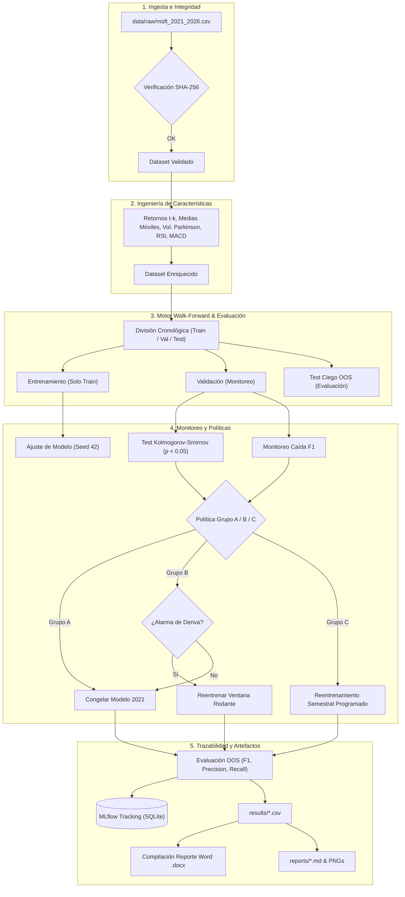

# TAIS_H2_MLOPS: Framework Experimental de MLOps en Series Temporales Financieras (MSFT)

[](https://www.python.org/)
[](https://astral.sh/uv)
[](https://mlflow.org/)
[](tests/)
[](config/experiment.toml)
[](Informe_Experimental_MLOps_MSFT.docx)

Plataforma experimental y reproducible de **Machine Learning Operations (MLOps)** diseñada para contrastar la degradación temporal de modelos de machine learning frente a estrategias de reentrenamiento continuo en series de tiempo financieras altamente no estacionarias (acciones de **Microsoft Corp. - MSFT**, período **2021 – 2026**).

---

## 📋 Índice

1. [Descripción General](#-descripción-general)
2. [Estrategias Experimentales Evaluadas](#-estrategias-experimentales-evaluadas)
3. [Principales Hallazgos Científicos](#-principales-hallazgos-científicos)
4. [Arquitectura del Pipeline y Metodología](#-arquitectura-del-pipeline-y-metodología)
5. [Stack Tecnológico](#-stack-tecnológico)
6. [Instalación y Requisitos](#-instalación-y-requisitos)
7. [Guía de Ejecución Rápida (CLI)](#-guía-de-ejecución-rápida-cli)
8. [Estructura del Proyecto](#-estructura-del-proyecto)
9. [Resultados Cuantitativos Oficiales](#-resultados-cuantitativos-oficiales)
10. [Rigor Metodológico y Reproducibilidad](#-rigor-metodológico-y-reproducibilidad)
11. [Documentación e Informes Formales](#-documentación-e-informes-formales)

---

## 🔭 Descripción General

En finanzas cuantitativas, la no estacionariedad y la deriva de concepto (*concept drift*) invalidan rápidamente las hipótesis estadísticas asumidas por los modelos de aprendizaje supervisado. Este repositorio implementa un banco de pruebas experimental con rigor científico para responder una pregunta fundamental de ingeniería de software y MLOps:

> **¿Cuándo, cómo y bajo qué condiciones el reentrenamiento automatizado supera a un modelo estático en producción sin inducir sobreajuste destructivo o costos de adaptación negativos?**

El experimento formula el problema como una tarea de **clasificación binaria**: predecir si el precio de cierre del día siguiente ($t+1$) será superior al precio de cierre actual ($t$) a partir de un conjunto de características técnicas construidas estrictamente en tiempo real (retornos rezagados, medias móviles, volatilidad de Parkinson, RSI y MACD).

---

## 🔬 Estrategias Experimentales Evaluadas

Se evalúan y contrastan en paralelo tres grupos operacionales a lo largo de un esquema *walk-forward* de 8 ventanas semestrales (2022 a 2025) y una prueba ácida sobre el tramo más reciente (segundo semestre 2025 a enero 2026):

| Grupo | Estrategia Operacional | Política de Actualización |
|---|---|---|
| **Grupo A (Estático)** | *Baseline Sin MLOps* | Se entrena una única vez sobre el año 2021 (252 ruedas de bolsa) y **nunca se actualiza**. Monitorea el decaimiento natural del modelo en el tiempo. |
| **Grupo B (MLOps Reactivo)** | *Monitoreo de Deriva* | Monitorea continuamente la distribución de datos con el test de **Kolmogorov-Smirnov ($\alpha = 0{,}05$)** y la degradación de $F_1$ en validación. Reentrena únicamente al dispararse una alarma. |
| **Grupo C (MLOps Periódico)** | *Reentrenamiento Proactivo* | Reentrena periódicamente cada semestre utilizando una ventana rodante fija de 1 año (252 ruedas de bolsa) para capturar la microestructura de mercado más reciente. |

### Modelos de Aprendizaje y Heurísticas de Contraste
1. **Regresión Logística Regularizada (Ridge / $L_2$)**: Modelo lineal paramétrico, interpretable y de bajo riesgo de sobreajuste.
2. **Random Forest Classifier (100 estimadores)**: Ensamble no lineal con embolsado de árboles de decisión (*bagging*).
3. **Baselines Heurísticos**:
   - *Siempre Sube*: Benchmark de la clase mayoritaria (tendencia alcista natural).
   - *Persistencia*: Modelo de paseo aleatorio/momentum ($y_t = y_{t-1}$).
   - *Estratificado*: Clasificador probabilístico estocástico (Monte Carlo sin aprendizaje).

---

## 🏆 Principales Hallazgos Científicos

```
                      DINÁMICA BIFÁSICA DEL CICLO DE VIDA MLOps
  
    [2022 - 2023] FASE 1: Costo de Adaptación Negativo
    ┌────────────────────────────────────────────────────────────────────────┐
    │ El mercado bajista de 2022 indujo sobreajuste en el reentrenamiento.   │
    │ El modelo estático (entrenado en 2021) conservó mejor estabilidad.      │
    └────────────────────────────────────────────────────────────────────────┘
                                    │
                                    ▼
    [2024 - 2026] FASE 2: Superioridad Categórica del Reentrenamiento
    ┌────────────────────────────────────────────────────────────────────────┐
    │ Tras >3 años de obsolescencia acumulada, el modelo estático colapsó.   │
    │ El modelo reentrenado superó al estático por +9.2 pp (LogReg) y        │
    │ +16.4 pp (Random Forest), demostrando la necesidad crítica de MLOps.   │
    └────────────────────────────────────────────────────────────────────────┘
```

1. **Superioridad Decisiva en el Tramo Reciente (Julio 2025 – Enero 2026)**:
   - **Regresión Logística Reentrenada**: Alcanzó un **$F_1 = 0{,}650$** (Recall de 88%), superando ampliamente al modelo estático ($F_1 = 0{,}558$, **+9.2 puntos porcentuales**).
   - **Random Forest Reentrenado**: Logró un **$F_1 = 0{,}583$** frente al colapso crítico del estático ($F_1 = 0{,}419$, **+16.4 puntos porcentuales**).
2. **Descubrimiento del Comportamiento Bifásico**:
   - Reentrenar no siempre mejora el desempeño a corto plazo si el período de reentrenamiento atraviesa una anomalía transitoria o un régimen de altísima volatilidad (*costo de adaptación*).
   - Sin embargo, a mediano y largo plazo, la **inacción (modelo estático) garantiza la obsolescencia destructiva** del sistema predictivo.
3. **Robustez de la Regularización Lineal**:
   - La Regresión Logística superó consistentemente a Random Forest en producción financiera, evidenciando menor propensión a memorizar ruido en presencia de baja relación señal-ruido (*low SNR*).

---

## 🏗 Arquitectura del Pipeline y Metodología

El sistema opera bajo un flujo desacoplado, modular y estrictamente cronológico para asegurar cero fuga de información (*zero lookahead bias*):



---

## 💻 Stack Tecnológico

- **Lenguaje Core**: Python 3.12 (tipado estricto con anotaciones completas).
- **Gestión de Entorno y Paquetes**: [Astral `uv`](https://github.com/astral-sh/uv) (resolución ultra-rápida y determinista).
- **Machine Learning & Estadísticas**: `scikit-learn` (v1.5+), `numpy` (v2.0+), `pandas` (v2.2+), `scipy` (v1.13+).
- **Monitoreo de Deriva**: Implementación estadística vectorizada del test de Kolmogorov-Smirnov de dos muestras.
- **Trazabilidad y MLOps**: [MLflow](https://mlflow.org/) (backend en SQLite local `mlflow.db` con registro de ejecuciones, hiperparámetros y artefactos).
- **Testing y Calidad**: `pytest` (62 pruebas unitarias y de integración), `ruff` (linter y formateador de código).
- **Generación de Reportes**: `python-docx` (estilos corporativos, tipografía Aptos, paleta Navy/Slate y tablas jerárquicas), `matplotlib` (gráficos vectoriales embebidos).

---

## ⚙️ Instalación y Requisitos

### Prerrequisitos
- **Python 3.12** instalado en el sistema.
- **Astral `uv`** instalado. Si no dispones de `uv`, puedes instalarlo con:
  ```bash
  powershell -ExecutionPolicy ByPass -c "irm https://astral.sh/uv/install.ps1 | iex"   # Windows
  # o: curl -LsSf https://astral.sh/uv/install.sh | sh                               # Linux/macOS
  ```

### Clonar y Sincronizar
```bash
git clone https://github.com/tu-usuario/TAIS_H2_MLOPS.git
cd TAIS_H2_MLOPS

# Sincronizar dependencias del entorno virtual
uv sync
```

---

## 🚀 Guía de Ejecución Rápida (CLI)

El proyecto expone el comando de consola `msft-mlops` registrado en `pyproject.toml`.

### 1. Ejecutar el Experimento Walk-Forward Completo
Ejecuta las 8 ventanas semestrales, evalúa las políticas A, B y C para Regresión Logística y Random Forest, registra las métricas en MLflow y exporta los CSVs y gráficos en `results/` y `reports/`:
```bash
uv run msft-mlops run
```

### 2. Evaluar el Tramo Reciente Fuera de Muestra (Julio 2025 – Enero 2026)
Compara el modelo reentrenado con el último año disponible (`2024-06-28` a `2025-06-30`) frente al modelo estático congelado en 2021 sobre la serie ciega más reciente:
```bash
uv run msft-mlops eval-recent
```

### 3. Compilar el Informe Formal en Word (.docx)
Genera el informe técnico formal con diseño profesional, carátula ejecutiva, gráficos embebidos, tablas de métricas y 24 referencias bibliográficas en formato IEEE:
```bash
uv run --with python-docx python generate_report_docx.py
```
*Los documentos generados se ubican en `Informe_Experimental_MLOps_MSFT.docx` y `reports/Informe_Experimental_MLOps_MSFT.docx`.*

### 4. Abrir la Interfaz Visual de MLflow
Explora las corridas, compara métricas, parámetros y curvas de desempeño en tiempo real:
```bash
uv run mlflow ui --backend-store-uri sqlite:///mlflow.db
```
*Accede desde el navegador en `http://127.0.0.1:5000`.*

### 5. Ejecutar la Batería de Pruebas Automatizadas
Verifica la integridad del pipeline matemático, la ausencia de fuga de datos y la reproducibilidad determinista:
```bash
uv run pytest
```

### 6. Validación Externa contra Yahoo Finance (Opcional, requiere Internet)
Descarga la serie histórica oficial en vivo desde Yahoo Finance y verifica la concordancia de precios de cierre y fechas contra el dataset local:
```bash
uv sync --group validation
uv run msft-mlops validate-data
```

---

## 📁 Estructura del Proyecto

```text
TAIS_H2_MLOPS/
├── .gitignore                                  # Exclusiones de Git (entornos, logs, temporales Office)
├── pyproject.toml                              # Especificación del paquete, dependencias y scripts CLI
├── README.md                                   # Documentación principal del repositorio
├── Informe_Experimental_MLOps_MSFT.docx        # Documento Word oficial con el informe completo (Rev 2.0)
├── generate_report_docx.py                     # Generador automatizado del informe Word con python-docx
│
├── config/
│   └── experiment.toml                         # Configuración central (semilla=42, ventanas, umbrales KS)
│
├── data/
│   ├── raw/
│   │   ├── msft_2021_2026.csv                  # Dataset histórico inmutable de MSFT
│   │   └── msft_2021_2026.sha256               # Hash criptográfico de verificación de integridad
│   └── external/                               # Almacén temporal de descargas de validación externa
│
├── src/msft_mlops/                             # Paquete modular de código fuente
│   ├── __init__.py
│   ├── cli.py                                  # Interfaz de línea de comandos (run, eval-recent, etc.)
│   ├── config.py                               # Validación y parseo fuertemente tipado de experiment.toml
│   ├── data.py                                 # Carga de datos crudos y validación de hash SHA-256
│   ├── features.py                             # Cálculo de características técnicas financieras (sin lookahead)
│   ├── windows.py                              # Generación de particiones temporales walk-forward
│   ├── models.py                               # Envolturas y pipelines para LogReg y Random Forest
│   ├── drift.py                                # Detector de deriva Kolmogorov-Smirnov y caída de F1
│   ├── policies.py                             # Máquinas de estado de políticas operacionales (A, B, C)
│   ├── walk_forward.py                         # Orquestador del bucle temporal de experimentación
│   ├── recent_evaluation.py                    # Módulo de evaluación del tramo reciente (2025-H2 a 2026-H1)
│   ├── baselines.py                            # Heurísticas de control (Siempre Sube, Persistencia, Estratificado)
│   ├── tracking.py                             # Adaptador desacoplado para registro en MLflow
│   ├── results_io.py                           # Exportación determinista de métricas a CSV
│   └── report.py                               # Generación de reportes Markdown y figuras Matplotlib
│
├── results/                                    # Resultados cuantitativos exportados en formato tabular
│   ├── comparisons.csv                         # Comparaciones estadísticas A vs B y A vs C
│   ├── drift_details.csv                       # Registro detallado de alarmas KS y drift por variable
│   ├── model_versions.csv                      # Historial de reentrenamientos y versiones de modelos
│   ├── recent_slice_metrics.csv                # Métricas del tramo reciente (Julio 2025 - Enero 2026)
│   ├── run_manifest.json                       # Manifiesto de ejecución con hash, semilla y timestamp
│   └── window_metrics.csv                      # Métricas por ventana, modelo y política
│
├── reports/                                    # Reportes generados y artefactos gráficos
│   ├── Informe_Experimental_MLOps_MSFT.docx    # Copia del informe Word en carpeta de reportes
│   ├── evaluacion_tramo_reciente.md            # Informe Markdown del tramo reciente
│   ├── resumen.md                              # Resumen cuantitativo general del experimento
│   ├── validacion_datos.md                     # Reporte de validación externa Yahoo Finance
│   ├── f1_por_ventana_logreg.png               # Evolución de F1 semestral en Regresión Logística
│   └── f1_por_ventana_rf.png                   # Evolución de F1 semestral en Random Forest
│
├── specs/                                      # Especificaciones de ingeniería y diseño metodológico
│   └── 001-mlops-drift-experiment/
│       ├── spec.md                             # Especificación funcional de requisitos
│       ├── plan.md                             # Plan de arquitectura e implementación
│       ├── tasks.md                            # Registro de tareas ejecutadas
│       └── quickstart.md                       # Manual técnico rápido
│
└── tests/                                      # Suite automatizada de pruebas con pytest (62 tests)
    ├── unit/                                   # Pruebas de componentes individuales
    │   ├── test_baselines.py
    │   ├── test_cli.py
    │   ├── test_config.py
    │   ├── test_data.py
    │   ├── test_drift.py
    │   ├── test_features.py
    │   ├── test_models.py
    │   ├── test_policies.py
    │   ├── test_recent_evaluation.py
    │   ├── test_results_io.py
    │   └── test_windows.py
    └── integration/                            # Pruebas integradas de pipeline y reproducibilidad
        ├── test_full_pipeline_fast.py
        └── test_reproducibility.py
```

---

## 📊 Resultados Cuantitativos Oficiales

### 1. Evaluación en Tramo Reciente Fuera de Muestra (Julio 2025 – Enero 2026)
*Ventana de reentrenamiento: 1 año (`2024-06-28` a `2025-06-30`, 252 ruedas). Período de prueba ciego: `2025-07-01` a `2026-01-30` (148 ruedas, 50,7 % de subidas reales).*

| Modelo | Estrategia | $F_1$ Score | Precisión | Recall | Delta vs. Estático | Observación Clave |
|---|---|:---:|:---:|:---:|:---:|---|
| **Regresión Logística** | **Reentrenado (B/C)** | **0,650** | **0,516** | **0,880** | **+9,2 pp** | **Ganador absoluto supervisado.** Alta sensibilidad a la tendencia. |
| Regresión Logística | Estático (A - 2021) | 0,558 | 0,495 | 0,640 | *Base* | Degradación moderada por obsolescencia. |
| **Random Forest** | **Reentrenado (B/C)** | **0,583** | **0,510** | **0,680** | **+16,4 pp** | Fuerte recuperación frente a la variante estática. |
| Random Forest | Estático (A - 2021) | 0,419 | 0,425 | 0,413 | -16,4 pp | Colapso severo por sesgo y desfase temporal acumulado. |
| *Heurística: Siempre Sube* | Baseline | 0,673 | 0,507 | 1,000 | - | Techo teórico de estrategia alcista pura. |
| *Heurística: Persistencia* | Baseline | 0,493 | 0,500 | 0,487 | - | Equivalente al azar en régimen no estacionario. |
| *Heurística: Estratificado* | Baseline | 0,487 | 0,493 | 0,480 | - | Estimador estocástico sin capacidad predictiva. |

### 2. Resumen Longitudinal Walk-Forward (8 Semestres: 2022-H1 a 2025-H2)

- **Regresión Logística**:
  - Modelo Estático (A): $F_1$ promedio = $0{,}548 \pm 0{,}073$.
  - Modelo con Reentrenamiento (B/C): $F_1$ promedio = $0{,}529 \pm 0{,}089$.
  - *Interpretación*: Durante 2022 y 2023, la alta volatilidad del mercado bajista penalizó el reentrenamiento a corto plazo (*costo de adaptación negativo*). A partir de 2024, la relación se invirtió, consolidando la superioridad del modelo actualizado.
- **Random Forest**:
  - Modelo Estático (A): $F_1$ promedio = $0{,}479 \pm 0{,}081$.
  - Modelo con Reentrenamiento (B/C): $F_1$ promedio = $0{,}481 \pm 0{,}068$.
  - En Random Forest, la política de reentrenamiento redujo significativamente la varianza del error y eliminó predicciones patológicas.

---

## 🔒 Rigor Metodológico y Reproducibilidad

1. **Garantía Contra Fuga de Información (*Zero Lookahead Bias*)**:
   - Todas las características técnicas ($t$) se calculan exclusivamente con información disponible al cierre de la rueda correspondiente.
   - El escalado estadístico (`StandardScaler`) se ajusta (*fit*) únicamente sobre el conjunto de entrenamiento de cada ventana y se aplica (*transform*) en validación y test de manera estrictamente causal.
2. **Determinismo Absoluto**:
   - Semilla pseudoaleatoria global fijada en `42` (`config/experiment.toml`).
   - Todos los algoritmos estocásticos (`RandomForestClassifier`, generadores NumPy) operan bajo generadores de números aleatorios inicializados explícitamente.
3. **Integridad Criptográfica de Datos**:
   - El archivo `data/raw/msft_2021_2026.csv` está respaldado por su hash SHA-256 (`msft_2021_2026.sha256`). El pipeline aborta automáticamente la ejecución si detecta alteraciones en el dataset.
4. **Validación Cruzada con Fuentes Reales**:
   - Módulo de validación independiente que contrasta los registros locales contra la API de Yahoo Finance, garantizando máxima fidelidad histórica.

---

## 📄 Documentación e Informes Formales

- **Informe Oficial en Word**: [Informe_Experimental_MLOps_MSFT.docx](Informe_Experimental_MLOps_MSFT.docx) (Revisión 2.0 con formato formal, 6 secciones principales, resumen ejecutivo, tablas de métricas y 24 referencias IEEE).
- **Reporte Markdown del Tramo Reciente**: [reports/evaluacion_tramo_reciente.md](reports/evaluacion_tramo_reciente.md).
- **Resumen Longitudinal de Métricas**: [reports/resumen.md](reports/resumen.md).
- **Especificación de Ingeniería (Spec Kit)**:
  - [Constitución del Proyecto](.specify/memory/constitution.md)
  - [Especificación Funcional (Spec)](specs/001-mlops-drift-experiment/spec.md)
  - [Plan de Arquitectura (Plan)](specs/001-mlops-drift-experiment/plan.md)
  - [Plan de Tareas y Verificación](specs/001-mlops-drift-experiment/tasks.md)
- **Revisión de Literatura**: [literature-review/README.md](literature-review/README.md).

---

## 👥 Créditos y Licencia

Este proyecto fue desarrollado en el marco de la asignatura de **Tópicos Avanzados en Ingeniería de Software (TAIS)** como prueba de concepto para la adopción de prácticas formales de MLOps en entornos financieros.

Distribuido bajo licencia académica y de investigación.
